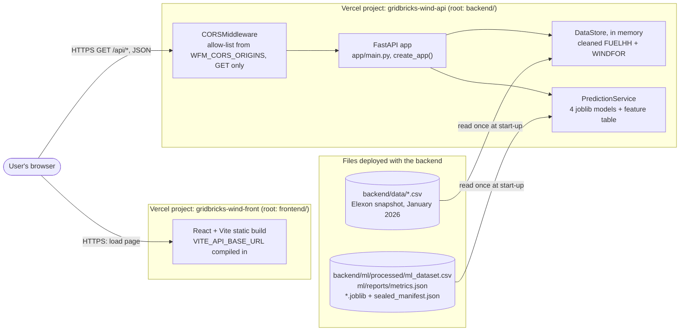
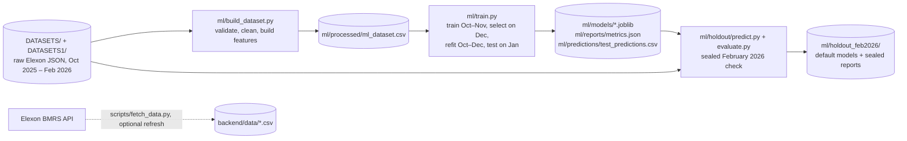

# GridBricks — Wind Forecast Intelligence

**Decision support for a UK utility's day-ahead power-buying desk: what the official wind forecast said when power had to be bought, how far it could be trusted, and two machine-learning extensions (a corrected forecast and a shortfall-risk estimate).**

## Live demo and deployment links

**Open the live dashboard → [gridbricks-wind-front.vercel.app](https://gridbricks-wind-front.vercel.app/)**

| What | Link | Notes |
| --- | --- | --- |
| **Live dashboard** (frontend website, React + Vite) | [gridbricks-wind-front.vercel.app](https://gridbricks-wind-front.vercel.app/) | The main demo. Open it in a browser |
| **Backend API service** (FastAPI) | [gridbricks-wind-api.vercel.app](https://gridbricks-wind-api.vercel.app/) | The REST API that the dashboard calls. It returns JSON; its root address redirects to the API documentation |
| **Backend health check** | [gridbricks-wind-api.vercel.app/api/health](https://gridbricks-wind-api.vercel.app/api/health) | Service status as JSON: data source, record counts and loaded models |
| **Interactive API documentation** (Swagger UI) | [gridbricks-wind-api.vercel.app/docs](https://gridbricks-wind-api.vercel.app/docs) | Try every endpoint from the browser |
| **Source code** (GitHub) | [github.com/Dh25Gitsh-hab/widwr](https://github.com/Dh25Gitsh-hab/widwr) | This repository |

The frontend and the backend are **two separate Vercel projects** built from this repository. The API serves a fixed snapshot of Elexon data stored in the repository (downloaded on 25 Oct 2026). It does not fetch data from Elexon on each request.

**Checked on 29 Oct 2026 from the command line:**
- **API:** all 12 `/api/*` endpoints returned HTTP 200, and out-of-scope dates returned 422.
- **CORS:** the API sent `Access-Control-Allow-Origin` for the dashboard's origin.
- **Dashboard:** the page and its JavaScript were served (HTTP 200), and the bundle points to the production API.
- **Live tests:** the 6 frontend live tests passed against the production API (see [Testing](#testing-and-quality-assurance)).
- **Dashboard rendering:** one of those tests renders the dashboard against the production API in a simulated browser (jsdom). It checks that the dashboard connects, shows the decision window, the decision overview and both default models, and shows no error state. The dashboard was not checked in a real browser.

The first request after a period of inactivity can take several seconds while Vercel starts a new backend instance.

---

## Overview

A buying desk purchases power on day D-1 for delivery on day D. How much it needs depends on how much wind the grid will produce, and that is uncertain. This project answers two questions for purchase decisions made in **January 2026**:

1. **What wind forecast did we actually have when we had to buy?** For every delivery hour it rebuilds the latest official forecast published before the day-ahead gate closure (09:50 UK time on D-1). No later information is used.
2. **How far can we trust it?** It measures that forecast against actual generation: typical error, systematic bias, the error range, and when the forecast is weakest.

On top of this, an ML extension serves a **corrected forecast** (the official forecast minus a predicted error) and an hourly **shortfall probability** (the chance that actual wind comes in at least 1 GW below the forecast).

- **Intended users:** analysts and traders on a day-ahead desk, and reviewers evaluating the method.
- **Practical value:** shows how the official forecast and its errors behaved at decision time, without hindsight.

> The app gives the desk information for its buying decisions; it does not make them. The predictions are model estimates evaluated on historical data. They are not guaranteed outcomes, operational instructions or trading advice, and no trading-profit claim is made.

**Contents:**
[Live demo](#live-demo-and-deployment-links) · [Scope](#scope) · [Features](#features) · [Screenshots](#screenshots) · [Technology stack](#technology-stack) · [Architecture](#system-architecture) · [Repository structure](#repository-structure) · [Data and provenance](#data-sources-and-provenance) · [Methodology](#forecasting-and-machine-learning-methodology) · [API reference](#api-reference) · [Local setup](#local-setup) · [Environment variables and CORS](#environment-variables-and-cors) · [Docker](#docker-and-docker-compose) · [Testing](#testing-and-quality-assurance) · [Deployment](#deployment-guide) · [Limitations](#limitations) · [AI tools](#use-of-ai-tools)

---

## Scope

The brief asks to "consider data relevant only for purchase decisions to be made in January 2026". A decision on day D-1 buys power for delivery day D, so January decisions (1–31 Jan) cover **delivery days 2 Jan – 1 Feb 2026**.

| Part | Data it uses | January-only? |
| --- | --- | --- |
| **Core application:** the forecast available at decision time, and its accuracy | January purchase decisions. The snapshot also holds forecasts published on 30–31 Dec, which the lead-time analysis needs | **Yes.** Every endpoint rejects other dates (HTTP 422), and tests enforce it |
| **ML predictions** served by the API | Features for the January decisions, built only from data published by each 09:50 cutoff. Models trained on deliveries 2 Oct – 31 Dec 2025 | **Yes,** for inputs and model weights |
| **ML model choice** (which model is the default) | January test results and an offline February check | **Disclosed deviation:** see [Model-selection history](#model-selection-history) |
| **February 2026 data and results** | An offline evaluation in `backend/ml/holdout_feb2026/`. The running application never loads February data or results | Outside the application scope; kept as supplementary evidence |

---

## Features

Each feature below was confirmed in the source code. The last column shows the API endpoint behind it.

| Feature | Where | Backed by |
| --- | --- | --- |
| **Decision overview:** summary cards for the selected day, and a timeline of the forecast run used, the 09:50 cutoff and the runs published too late | Dashboard, "Decision overview" | `/api/ml/predictions`, `/api/forecasts/day-ahead` |
| **Decision-date selection** (1–31 Jan 2026), validated against the window the backend reports | Dashboard filter bar | `/api/health` |
| **Forecast chart and table:** hourly official forecast at the cutoff, the corrected forecast, and actual generation (labelled as hindsight) | Dashboard, "Wind generation forecast" | `/api/ml/predictions` |
| **Shortfall-risk chart and table:** hourly probability of a shortfall of at least 1 GW, with the hours where one actually occurred marked | Dashboard, "Shortfall risk" | `/api/ml/predictions` |
| **Accuracy views:** daily error across January (click a day to select it); whole-period scores for the official vs corrected forecast; the official forecast's January metrics; the models' January test scores | Dashboard, "Forecast accuracy" | `/api/ml/predictions`, `/api/analytics/summary`, `/api/ml/models` |
| **Model selection and comparison:** choose the default or the comparison model for each task. The page states when a comparison model is shown | Dashboard filter bar, "Models" section | `/api/ml/models`, `/api/ml/predictions` |
| **Model cards:** inputs, training period, how each model was chosen, saved file and SHA-256 fingerprint | Dashboard, "Models" | `/api/ml/models` |
| **Data and method notes:** source, snapshot date, definitions of the metrics, limitations, live backend status | Dashboard, "Data & method" | `/api/health` |
| **Navigation and status:** sidebar and top-bar section links; backend-connection status; clear error, loading and retry states | Dashboard layout | `/api/health` |
| **Further analytics via the API:** raw forecast runs, half-hourly time series, accuracy by hour, day or forecast size, accuracy vs lead time, a configurable cutoff | API only (not shown in the dashboard) | `/api/forecasts`, `/api/analytics/timeseries`, `/breakdown`, `/horizon`; the `gate_closure` parameter |
| **Data-cleaning audit trail:** rows removed by each cleaning rule | `/api/health`, dashboard "Data & method" | `/api/health` |
| **Health check and interactive API docs** | API | `/api/health`, `/docs`, `/openapi.json` |

---

## Screenshots

No screenshots are committed to the repository yet. To add them, save PNG files in a folder such as `docs/screenshots/` and reference them here with relative paths.

---

## Technology stack

The versions are those pinned in `backend/requirements.txt`, `backend/requirements-dev.txt` and `frontend/package.json`.

| Category | Technology | Used for |
| --- | --- | --- |
| **Frontend** | React 18.3.1, Vite 6.3.5, plain CSS | Single-page dashboard. There is no client-side router; navigation is by in-page section anchors |
| **Data visualisation** | Recharts 2.15.3 | Forecast, risk and daily-accuracy charts |
| **Backend** | Python 3.12, FastAPI 0.162.0, Uvicorn 0.54.0, pydantic-settings 2.16.1 | REST API, validation, typed configuration from environment variables |
| **Data processing** | pandas 3.1.0, NumPy 2.5.4, tzdata 2026.5 | Cleaning, as-of joins, time-zone handling (Europe/London) |
| **Machine learning** | scikit-learn 1.9.1, joblib 1.6.0 | Linear, logistic and Random Forest models; saving and loading model files |
| **Data access** | httpx 0.28.1 | Elexon API client, used only to refresh the snapshot (optional); also used by FastAPI's test client |
| **Testing and quality** | pytest 9.1.1; Vitest 3.1.4, Testing Library, jsdom 26.1.0; ESLint 9.25.1 | Backend and frontend tests, linting |
| **Containerisation** | Docker (python:3.12-slim, node:22-alpine, nginx:alpine), Docker Compose | Local, reproducible two-container run |
| **Deployment** | Vercel (two projects) | Production hosting of the frontend (static build) and the backend (FastAPI as a Python function) |

There is no database. The data is small, so it is loaded into memory at start-up from files committed to the repository.

---

## System architecture

### Production (two Vercel projects)



**How a request flows:**
1. The browser loads the static dashboard from `gridbricks-wind-front`.
2. The dashboard calls the API on `gridbricks-wind-api` directly over HTTPS. The API base URL is compiled into the bundle at build time.
3. At start-up, FastAPI's lifespan hook:
   - reads the CSV snapshot in `backend/data/`, cleans it and keeps it in memory;
   - loads the feature table, the evaluation report and the four model files from `backend/ml/`.
4. Requests are answered from memory. Predictions are computed at request time by the loaded scikit-learn models from pre-built, leakage-free feature rows.
5. Responses are JSON, and the dashboard renders them with Recharts.

Vercel builds both projects from the source in this repository. It does **not** run the Docker images; those are for local use (see [Docker](#docker-and-docker-compose)).

### Offline pipeline (not run in production)



---

## Repository structure

```text
.
├── backend/                     Python FastAPI service (Vercel root directory: backend)
│   ├── app/
│   │   ├── main.py              application factory create_app(); start-up loading; CORS; routers
│   │   ├── config.py            settings from WFM_* environment variables (pydantic-settings)
│   │   ├── api/                 dependencies.py (shared validation) and routes/ (health, forecasts, analytics, ml)
│   │   ├── models/              schemas.py (response models) and ml_model.py (model candidates, scoring, ModelBundle)
│   │   ├── services/            elexon_client, data_processor (cleaning), data_store, forecast_evaluator,
│   │   │                        feature_builder, prediction_service
│   │   └── utils/               timestamps.py (UTC / UK time, gate closure, DST)
│   ├── data/                    runtime snapshot: fuelhh_wind_raw.csv, windfor_raw.csv, snapshot_meta.json
│   ├── ml/                      offline ML workflow and its outputs
│   │   ├── build_dataset.py     raw DATASETS* files → validated, leakage-free feature table
│   │   ├── train.py             candidate training, selection, January test, reports
│   │   ├── processed/           ml_dataset.csv (the feature table the API serves from)
│   │   ├── models/              Random Forest models (comparison models in the API)
│   │   ├── reports/             metrics.json, data_validation.json, dataset_summary.json
│   │   ├── predictions/         test_predictions.csv (January predictions of every candidate)
│   │   ├── holdout/             code for the sealed February 2026 check
│   │   ├── holdout_feb2026/     default models (linear, logistic), sealed predictions and reports
│   │   └── v2/                  offline improvement experiments; never used by the application
│   ├── scripts/fetch_data.py    optional: re-download the snapshot from Elexon
│   ├── tests/                   pytest suite
│   ├── Dockerfile, requirements.txt, requirements-dev.txt, pytest.ini, .env.example
│   └── README.md                backend guide and full API reference
├── frontend/                    React + Vite dashboard (Vercel root directory: frontend)
│   ├── src/                     App.jsx, api/ (client), components/, hooks/, lib/, styles/, test/ (fixtures)
│   ├── public/                  favicon
│   ├── Dockerfile, .dockerignore, .env.example, package.json, vite.config.js, eslint.config.js
│   └── README.md                frontend guide
├── DATASETS/                    raw Elexon FUELHH wind actuals, monthly JSON, Oct 2025 – Feb 2026 (read-only)
├── DATASETS1/                   raw Elexon WINDFOR wind forecasts, monthly JSON, Oct 2025 – Feb 2026 (read-only)
├── docs/
│   ├── BACKEND_DESIGN.md        backend architecture, decisions and trade-offs
│   └── DATA_FINDINGS.md         data dictionary, profiling, processing rules and January findings
├── docker-compose.yml           local two-container run (services: backend, frontend)
├── .dockerignore, .gitignore
└── README.md
```

---

## Data sources and provenance

### Source

All data is UK national wind data in the format of **Elexon's BMRS / Insights Solution** datasets. Elexon is the GB electricity market's balancing and settlement code administrator.

| Dataset | What it is | Elexon service used by `backend/app/services/elexon_client.py` |
| --- | --- | --- |
| **FUELHH** | Half-hourly outturn generation by fuel type (the project uses `fuelType = WIND`) | `https://data.elexon.co.uk/bmrs/api/v1/datasets/FUELHH/stream` |
| **WINDFOR** | Wind generation forecasts: one "run" per `publishTime`, hourly values | `https://data.elexon.co.uk/bmrs/api/v1/datasets/WINDFOR/stream` |

No API key is needed, and no other data provider is used. The data dictionary is in [docs/DATA_FINDINGS.md](docs/DATA_FINDINGS.md).

### What each data location contains

| Location | Content | Used by |
| --- | --- | --- |
| `DATASETS/` | 5 monthly FUELHH JSON files (`Oct25_Actual.json` … `Feb26_Actual.json`): 7,250 half-hourly records, `startTime` 30 Sep 2025 23:00 UTC – 28 Feb 2026 23:30 UTC | Offline only: building the ML dataset, training, the February check |
| `DATASETS1/` | 5 monthly WINDFOR JSON files (`Oct25_Forecast.json` … `Feb26_Forecast.json`): 88,208 records, runs published 1 Oct 2025 – 28 Feb 2026 | Offline only (as above) |
| `backend/data/` | The **runtime snapshot** that the API serves: `fuelhh_wind_raw.csv` (1,536 half-hours, settlement dates 1 Jan – 1 Feb 2026) and `windfor_raw.csv` (19,856 values, runs published 30 Dec 2025 – 1 Feb 2026). `snapshot_meta.json` records the download from the Elexon API at 2026-10-25T19:31:49Z | The running API: forecast and accuracy endpoints |
| `backend/ml/processed/ml_dataset.csv` | The **processed feature table**: 2,929 delivery hours × 18 columns (IDs, 9 features, 3 labels, split) built from `DATASETS*` for Oct 2025 – Jan 2026. Only the 744 January "test" hours are served | The running API: ML endpoints |
| `backend/ml/models/`, `backend/ml/holdout_feb2026/models/` | **Trained model files** (joblib) | The running API: ML endpoints |
| `backend/ml/v2/data/raw/` | Older history downloaded for an offline experiment. Outside the January scope; not used by the application | `backend/ml/v2` experiments only |

The running application does **not** read `DATASETS/` or `DATASETS1/`. They are excluded from the Docker build context and are not needed by the Vercel backend.

### From raw data to features

1. **Cleaning** (`app/services/data_processor.py`):
   - **Actuals:** keep only wind; parse timestamps to UTC; drop rows that can't be parsed; keep the latest publication of each half-hour.
   - **Forecasts:** parse; drop "past targets", that is, values for hours that had already started when the run was published (they were never a forecast); drop exact duplicates; add the lead time `horizon_hours`.
   - **Counting:** every removed row is counted and reported by `/api/health`. Missing values stay missing; they are never filled with zero.
2. **Decision-time selection** (`app/services/forecast_evaluator.py`): for each delivery hour, take the latest run published at or before the cutoff (`pandas.merge_asof`). The cutoff defaults to 09:50 UK time on D-1 and is DST-aware.
3. **Features** (`app/services/feature_builder.py`): 9 features per delivery hour, each using only information published by the cutoff (see [Methodology](#forecasting-and-machine-learning-methodology)).

### Observed runtime values

`/api/health` in production returned the following on 29 Oct 2026. These are the deployed service's own counts, not independently audited official statistics:

| Field | Value |
| --- | --- |
| `data_source` | `snapshot` |
| `snapshot_fetched_at` | `2026-10-25T19:31:49Z` |
| `decision_dates` | 2026-01-01 → 2026-01-31 |
| `delivery_dates` | 2026-01-02 → 2026-02-01 |
| `actual_intervals` | 1,536 (FUELHH: 1,536 raw rows, 0 removed) |
| `forecast_values` | 15,775 (WINDFOR: 19,856 raw rows, 4,081 "past target" values removed) |
| `forecast_runs` | 272 |

### What has and has not been verified

| Check (run 28 Oct 2026, local scripts) | Result |
| --- | --- |
| Rebuilding `ml_dataset.csv` from `DATASETS*` (`python -m ml.build_dataset --output-dir <temp>`) | **Identical** to the committed file (2,929 × 18) |
| Snapshot forecasts vs `DATASETS1` | All 19,856 snapshot forecast records appear in `DATASETS1` with identical values |
| Snapshot actuals vs `DATASETS` | 1,488 of 1,536 snapshot half-hours appear in `DATASETS` with identical values. The other 48 are 1 Jan 2026, which the monthly files do not cover |
| Served forecast and actuals vs the ML feature table (744 January hours) | Identical (0.00 MW difference, same forecast runs) |
| `DATASETS*` file fingerprints | All 10 match the SHA-256 values recorded on 26 Oct 2026 |

**Not verified:**
- **Original download of `DATASETS/` and `DATASETS1/`:** who downloaded them and when. They carry Elexon's record format, but there is no download metadata.
- **Oct–Dec 2025 and Feb 2026:** these records were not compared with a second source.
- **The snapshot's download record:** it was not re-checked against Elexon (that would require a new download), so later Elexon revisions are also not checked.
- **`backend/ml/v2/data/raw/`:** not checked.

---

## Forecasting and machine-learning methodology

Full details, including all tables, are in [backend/ml/README.md](backend/ml/README.md) and [backend/ml/holdout_feb2026/README.md](backend/ml/holdout_feb2026/README.md).

### Decision cutoff and sign convention

- **Cutoff:** for delivery hour *t* on day D, the cutoff is **09:50 UK local time on D-1** (Nord Pool GB day-ahead gate closure), converted to UTC with daylight saving handled. Only forecasts and actuals published at or before the cutoff may be used. A different cutoff (`gate_closure=HH:MM`) can be passed to the analytics endpoints. The ML models were trained and are served for 09:50 only.
- **Sign convention:** `error = forecast − actual` (MW). A positive error means an over-forecast: less wind than planned, so the buyer ends up short.

### The official forecast's January accuracy

Recomputed by the production API (`/api/analytics/summary`, `/api/analytics/breakdown?by=forecast_level`) on 29 Oct 2026:

| Measure | Value |
| --- | --- |
| Typical error (MAE) | **1,995.6 MW** (about 2.0 GW), 17.7% of mean actual generation |
| Systematic bias | **+1,728.0 MW**: the forecast was too high in **84.3%** of the 744 hours |
| When the forecast was above 15 GW | Bias **+2,750.9 MW** |
| Error range (10th–90th percentile) | −502.7 to +4,183.9 MW: actual wind was between about 0.5 GW above and 4.2 GW below the forecast |

Taking the forecast at face value would have meant systematically buying too little power. More detail is in [docs/DATA_FINDINGS.md](docs/DATA_FINDINGS.md).

### Two prediction tasks

| Task | Target (label) | Output served |
| --- | --- | --- |
| **Corrected forecast** (regression) | `error_mw = forecast_mw − actual_mw` | `corrected_forecast_mw = forecast_mw − predicted error` |
| **Shortfall risk** (classification) | `shortfall_1gw = 1 if forecast_mw − actual_mw ≥ 1,000 MW` | `shortfall_probability` for each hour |

Predicting the *error* keeps the official forecast as the anchor; the model only learns a correction.

### Features (all known at the cutoff)

| Feature | Meaning |
| --- | --- |
| `forecast_mw` | Official forecast for the hour, the latest published by the cutoff |
| `lead_hours` | Hours between that forecast's publication and the target hour |
| `hour_uk` | UK clock hour of the target hour |
| `forecast_revision_mw` | Change versus the previous run's forecast for the same hour |
| `forecast_spread_mw` | Standard deviation of all forecasts for the hour published in the 24 h before the cutoff |
| `forecast_ramp_mw` | Forecast change from the previous hour in the same run |
| `forecast_day_mean_mw` | Mean forecast over the delivery day |
| `latest_actual_mw` | Most recent actual generation already published at the cutoff |
| `recent_error_mw` | Mean day-ahead error over the last 24 h whose actuals were published by the cutoff |

### Splits, training and selection

| Split | Purchase decisions | Delivery hours |
| --- | --- | --- |
| Train | 1 Oct – 30 Nov 2025 | 1,465 |
| Validation | 1 – 31 Dec 2025 | 720 |
| Test (served by the API) | 1 – 31 Jan 2026 | 744 |

**Training and selection (`ml/train.py`):**
1. Every candidate is fitted on train and scored on validation.
2. The rule fixed in advance chooses the lowest **validation MAE** (regression) or the lowest **validation Brier score** (classification).
3. Every candidate is then refitted on train + validation (deliveries 2 Oct – 31 Dec 2025) and scored once on the January test set.

**Candidates:**
- **Regression:**
  - `official_forecast` (no correction);
  - `mean_bias`;
  - `linear_by_level` (a straight line in `forecast_mw`);
  - `random_forest` (all 9 features);
  - `gradient_boosting`.
- **Classification:**
  - `base_rate`;
  - `logistic_by_level` (logistic regression on `forecast_mw`);
  - `random_forest`;
  - `gradient_boosting`.

Random seeds are fixed, so a rerun gives the same numbers.

### Models served by the API

`/api/health` and `/api/ml/models` both report these models, and the names match `REGRESSOR_FILES` and `CLASSIFIER_FILES` in `app/services/prediction_service.py`:

| Task | Model | Role | Inputs | Artifact (under `backend/ml/`) |
| --- | --- | --- | --- | --- |
| Corrected forecast | `linear_by_level` | **default** | `forecast_mw` | `holdout_feb2026/models/regression_linear_by_level.joblib` |
| Corrected forecast | `random_forest` | comparison | all 9 features | `models/error_regressor.joblib` |
| Shortfall risk | `logistic_by_level` | **default** | `forecast_mw` | `holdout_feb2026/models/classification_logistic_by_level.joblib` |
| Shortfall risk | `random_forest` | comparison | all 9 features | `models/shortfall_classifier.joblib` |

The served linear correction is `predicted error = 0.235936 × forecast_mw − 1,373.53 MW`.

### Model-selection history

1. **Before January:** the rule fixed in advance (lowest December validation error) chose the **Random Forest** for both tasks.
2. **January test:** the simpler linear correction scored better (MAE 1,178.6 vs 1,381.3 MW). From then on, January results had shaped the preference.
3. **February 2026 offline check:** predictions were sealed before any February actual was read. The linear correction was the only model clearly better than the official forecast, and the logistic model was the better-calibrated shortfall model.
4. **Approval (2026-10-26):** the linear correction and the logistic model became the defaults. Both Random Forests remain as comparison models.

So the **choice** of defaults used evidence from after the January decisions; the prediction inputs and model weights did not. `GET /api/ml/models` states this and marks which models the pre-January rule chose (`selected_by_pre_january_rule`). The defaults are a selection for the current application, not proof of long-term superiority.

### Loading, validation and leakage prevention

At start-up, `PredictionService` loads the feature table (January test rows only), `metrics.json` and the four joblib files.

**It refuses to serve (the ML endpoints then return 503, and the rest of the API keeps working) if:**
- any row was not built for the 09:50 cutoff, or uses a forecast published after it;
- a model reads a label column (`actual_mw`, `error_mw`, `shortfall_1gw`);
- the feature table lacks a column a model needs, or has an hour without a forecast.

**Fingerprints:** each model file's SHA-256 is compared with `holdout_feb2026/sealed_manifest.json` and reported as `matches_holdout_artifact`.

**Tests that enforce this:**
- **Feature leakage:** `tests/test_feature_builder.py` changes "future" forecasts and actuals and checks that no feature moves, including across the clock change.
- **Service guards:** `tests/test_ml_api.py` checks the refusals above, and that the served predictions equal the saved January predictions.
- **Scope:** `tests/test_scope.py` enforces the January-only window.

### Evaluation results

All numbers come from `backend/ml/reports/metrics.json` (January 2026 test, 744 hours) and `backend/ml/holdout_feb2026/reports/holdout_metrics.json` (February check, 648 hours).

**Corrected forecast, January test (MW):**

| Model | MAE | RMSE | Bias | MAE vs official |
| --- | --- | --- | --- | --- |
| official_forecast | 1,995.6 | 2,498.8 | +1,728.0 | — |
| mean_bias | 1,396.5 | 1,834.1 | +325.1 | −30.0% |
| **linear_by_level** (default) | **1,178.6** | 1,535.1 | +31.2 | **−40.9%** |
| random_forest (comparison; pre-January choice) | 1,381.3 | 1,739.6 | −22.1 | −30.8% |
| gradient_boosting | 1,551.2 | 1,912.5 | −88.8 | −22.3% |

For the Random Forest, the January MAE reduction vs official is 614.3 MW (95% interval 200.6–1,054.1 MW, day-block bootstrap).

**Corrected forecast, February 2026 check (MW):**
- **Official forecast:** MAE 1,692.7.
- **Random Forest:** MAE 1,297.9 (−23.3%). The interval for its gain includes zero.
- **Linear correction:** MAE 1,082.1 (−36.1%). The gain over official is 610.5 MW (95% interval 289.8–955.0, 3-day blocks).
- **Random Forest vs linear:** inconclusive.

**Shortfall risk, January test:**

| Model | Brier ↓ | ROC-AUC | PR-AUC | Precision | Recall | F1 |
| --- | --- | --- | --- | --- | --- | --- |
| base_rate | 0.2434 | 0.500 | 0.6599 | 0.6599 | 1.000 | 0.7951 |
| **logistic_by_level** (default) | **0.2015** | **0.755** | 0.8743 | 0.778 | 0.6925 | 0.7328 |
| random_forest (comparison) | 0.2209 | 0.7232 | 0.8644 | 0.7574 | 0.7251 | 0.7409 |
| gradient_boosting | 0.2448 | 0.727 | 0.8646 | 0.7479 | 0.7373 | 0.7426 |

**Shortfall risk, February check:**
- **Logistic:** ROC-AUC 0.6932, Brier 0.2151.
- **Random Forest:** ROC-AUC 0.6904, Brier 0.2437.
- **Observed shortfall rate:** 62.2%.

**How to read these numbers:**
- **MAE:** the average absolute error in MW. Lower is better.
- **Bias:** the average signed error.
- **Brier score:** the mean squared error of the probabilities. Lower is better.
- **ROC-AUC:** the chance that a random shortfall hour gets a higher risk than a random non-shortfall hour (0.5 = no skill).
- **Shortfalls are common** (66% of January hours), so plain accuracy is not informative: always predicting "shortfall" reaches 0.66.
- **Scope of the scores:** they measure forecast accuracy on one test month and one later check month. They are not evidence of trading profit.
- **February:** it was used to confirm the choice of defaults, so it is not an untouched holdout.

---

## API reference

The base URL is `https://gridbricks-wind-api.vercel.app` in production, or `<LOCAL_BACKEND_URL>` when you run the backend yourself (see [Local setup](#local-setup)).

- **Interactive docs:** **`/docs`** (Swagger UI), with the schema at `/openapi.json`; `/` redirects to `/docs`.
- **Method:** all endpoints are `GET` and return JSON.
- **Times:** in UTC.
- **Dates:** **UK delivery dates** (`YYYY-MM-DD`) within 2026-01-02 … 2026-02-01.
- **Errors:** **422** for invalid or out-of-window input, and **503** if data or models could not be loaded.

The response examples below are **trimmed excerpts of real production responses** (29 Oct 2026).

| Method and path | Purpose |
| --- | --- |
| `GET /api/health` | Service status, data provenance, cleaning counts, loaded models |
| `GET /api/forecasts` | Raw forecast records for a period, optionally only those published before a moment |
| `GET /api/forecasts/day-ahead` | Decision view for one delivery day |
| `GET /api/analytics/summary` | Headline accuracy of the official decision-time forecast |
| `GET /api/analytics/timeseries` | Half-hourly actual, forecast and error |
| `GET /api/analytics/breakdown` | Accuracy by hour of day, delivery day or forecast size |
| `GET /api/analytics/horizon` | Accuracy vs forecast lead time |
| `GET /api/ml/corrected-forecast` | Corrected forecast (regression), hour by hour |
| `GET /api/ml/shortfall-risk` | Shortfall probability (classification), hour by hour |
| `GET /api/ml/predictions` | Both ML components side by side (used by the dashboard) |
| `GET /api/ml/models` | Served models: role, inputs, fingerprint, January scores, selection history |
| `GET /api/ml/evaluate` | The full January model comparison as written by `ml/train.py` |

### `GET /api/health`

Reports service and data status. It returns HTTP 503 with `status: "unavailable"` if the data failed to load. If only the ML models failed, it returns 200 and `ml_models` starts with `unavailable:`.

```bash
curl https://gridbricks-wind-api.vercel.app/api/health
```

```json
{
  "status": "ok",
  "data_source": "snapshot",
  "snapshot_fetched_at": "2026-10-25T19:31:49Z",
  "decision_dates": {"first": "2026-01-01", "last": "2026-01-31"},
  "delivery_dates": {"first": "2026-01-02", "last": "2026-02-01"},
  "actual_intervals": 1536,
  "forecast_values": 15775,
  "forecast_runs": 272,
  "cleaning": [{"dataset": "WINDFOR (wind generation forecast)", "raw_rows": 19856, "past_target_rows": 4081, "clean_rows": 15775, "...": "..."}],
  "ml_models": "loaded: corrected_forecast=linear_by_level (default) + random_forest, shortfall_risk=logistic_by_level (default) + random_forest"
}
```

### `GET /api/forecasts`

Returns every forecast record targeting the delivery period.

**Parameters:**
- `start`, `end`: delivery dates.
- `published_before`: ISO-8601, UTC if no offset. Keeps only runs published at or before that moment.

```bash
curl "https://gridbricks-wind-api.vercel.app/api/forecasts?start=2026-01-15&end=2026-01-15"
# only what was known at the 14 Jan 09:50 cutoff:
curl "https://gridbricks-wind-api.vercel.app/api/forecasts?start=2026-01-15&end=2026-01-15&published_before=2026-01-14T09:50:00Z"
```

```json
{"period": {"first": "2026-01-15", "last": "2026-01-15"}, "published_before": null, "count": 463,
 "records": [{"start_time": "2026-01-15T00:00:00Z", "publish_time": "2026-01-13T02:30:00Z", "generation_mw": 13924.0, "horizon_hours": 45.5}]}
```

### `GET /api/forecasts/day-ahead`

Returns the decision view for one delivery day:
- the cutoff;
- the forecast run used and how fresh it was;
- the expected profile;
- hindsight accuracy;
- 48 half-hourly intervals;
- every run covering the day.

**Parameters:**
- `delivery_date` (required).
- `gate_closure`: `HH:MM` UK time; default `09:50`.

```bash
curl "https://gridbricks-wind-api.vercel.app/api/forecasts/day-ahead?delivery_date=2026-01-15"
```

```json
{"delivery_date": "2026-01-15", "decision_date": "2026-01-14", "decision_cutoff": "2026-01-14T09:50:00Z",
 "forecast_run_used": "2026-01-14T09:30:00Z", "minutes_before_cutoff": 20.0,
 "expected": {"mean_mw": 11678.0, "min_mw": 8957.0, "max_mw": 15828.0, "...": "..."},
 "hindsight": {"mae": 1093.6, "...": "..."},
 "intervals": [{"start_time": "2026-01-15T12:00:00Z", "actual_mw": 9742.0, "forecast_mw": 11178.0, "error_mw": 1436.0,
                "publish_time": "2026-01-14T09:30:00Z", "horizon_hours": 26.5}],
 "runs": [{"publish_time": "...", "available_at_decision": true, "used_for_decision": true, "points": ["..."]}]}
```

### `GET /api/analytics/summary`, `/timeseries`, `/breakdown`

**Shared parameters:**
- `start`, `end`: delivery dates; the default is the whole window.
- `policy`: `day_ahead` (default) or `fixed_horizon`.
- `gate_closure`: `HH:MM` UK time.
- `horizon_hours`: 0–48, used by `fixed_horizon`.

`/breakdown` also takes `by`: `hour_of_day` (default), `delivery_date` or `forecast_level`.

```bash
curl https://gridbricks-wind-api.vercel.app/api/analytics/summary
curl "https://gridbricks-wind-api.vercel.app/api/analytics/timeseries?start=2026-01-15&end=2026-01-15"
curl "https://gridbricks-wind-api.vercel.app/api/analytics/breakdown?by=forecast_level"
```

```json
{"period": {"first": "2026-01-02", "last": "2026-02-01"},
 "policy": {"kind": "day_ahead", "gate_closure_uk": "09:50", "description": "Latest forecast published by 09:50 UK time on the day before delivery"},
 "metrics": {"intervals_scored": 744, "coverage_pct": 100.0, "mae": 1995.6, "rmse": 2498.8, "bias": 1728.0,
             "error_p10": -502.7, "error_p90": 4183.9, "nmae_pct": 17.7, "over_forecast_pct": 84.3, "...": "..."}}
```

- **`/timeseries`** returns `points`, half-hourly: `start_time`, `actual_mw`, `forecast_mw`, `error_mw`, `publish_time`, `horizon_hours`. Forecast fields are filled on the hour.
- **`/breakdown`** returns `rows` with `group`, `n`, `mae`, `rmse`, `bias`, `error_p10`, `error_p90`, `mean_actual` and `mean_forecast`. For example, `{"group": "15+ GW", "n": 297, "mae": 2768.4, "bias": 2750.9, ...}`.

### `GET /api/analytics/horizon`

Returns accuracy when only forecasts published at least *h* hours ahead are used.

**Parameters:**
- `start`, `end`.
- `max_hours`: 1–48, default 48.
- `step_hours`: 1–12, default 1.

```bash
curl "https://gridbricks-wind-api.vercel.app/api/analytics/horizon?max_hours=24&step_hours=12"
```

```json
{"rows": [{"horizon_hours": 0,  "mean_lead_hours": 1.6,  "n": 744, "mae": 1679.9, "bias": 1471.1, "...": "..."},
          {"horizon_hours": 12, "mean_lead_hours": 13.6, "n": 744, "mae": 1791.2, "bias": 1595.1, "...": "..."},
          {"horizon_hours": 24, "mean_lead_hours": 25.6, "n": 744, "mae": 1932.2, "bias": 1736.2, "...": "..."}]}
```

### `GET /api/ml/corrected-forecast` and `GET /api/ml/shortfall-risk`

These are the two ML components, served separately.

**Parameters:**
- `start`, `end`: default, all served days.
- `model`: for the corrected forecast, `linear_by_level` (default) or `random_forest`; for shortfall risk, `logistic_by_level` (default) or `random_forest`.

Each response has `period`, `model` (name, role, inputs, training dates), `scores` for the period, and hourly `points`.

```bash
curl "https://gridbricks-wind-api.vercel.app/api/ml/corrected-forecast?start=2026-01-15&end=2026-01-15"
curl "https://gridbricks-wind-api.vercel.app/api/ml/shortfall-risk?start=2026-01-15&end=2026-01-15&model=random_forest"
```

- **Corrected-forecast points:** `start_time`, `publish_time`, `decision_cutoff`, `forecast_mw`, `corrected_forecast_mw`, `actual_mw`, `error_mw`, `corrected_error_mw`.
- **Shortfall-risk points:** `start_time`, `publish_time`, `decision_cutoff`, `forecast_mw`, `shortfall_probability`, `shortfall_occurred`.

### `GET /api/ml/predictions`

Returns both components side by side. This is the call the dashboard uses.

**Parameters:**
- `start`, `end`.
- `regressor`: `linear_by_level` or `random_forest`.
- `classifier`: `logistic_by_level` or `random_forest`.

```bash
curl "https://gridbricks-wind-api.vercel.app/api/ml/predictions?start=2026-01-15&end=2026-01-15"
```

```json
{"period": {"first": "2026-01-15", "last": "2026-01-15"},
 "regressor": {"name": "linear_by_level", "role": "default", "inputs": ["forecast_mw"], "...": "..."},
 "classifier": {"name": "logistic_by_level", "role": "default", "...": "..."},
 "scores": {"official": {"mae": 1093.6, "rmse": 1229.4, "bias": 1093.6}, "corrected": {"mae": 864.0, "rmse": 984.7, "bias": -288.1}},
 "points": [{"start_time": "2026-01-15T12:00:00Z", "publish_time": "2026-01-14T09:30:00Z", "decision_cutoff": "2026-01-14T09:50:00Z",
             "forecast_mw": 11178.0, "corrected_forecast_mw": 9914.2, "shortfall_probability": 0.4868,
             "actual_mw": 9742.0, "error_mw": 1436.0, "corrected_error_mw": 172.2, "shortfall_occurred": true}]}
```

`actual_mw`, `error_mw`, `corrected_error_mw` and `shortfall_occurred` are **hindsight values** for evaluation. They are not model inputs.

### `GET /api/ml/models` and `GET /api/ml/evaluate`

**`/api/ml/models`** returns:
- `status`: the selection-history statement;
- `decision_cutoff_uk`: `"09:50"`;
- `decision_dates` and `served_period`;
- one entry per model under `corrected_forecast` and `shortfall_risk`.

Each model entry includes `name`, `role`, `inputs`, `trained_from`/`trained_to`, `artifact`, `sha256`, `matches_holdout_artifact`, `january_test` and `selected_by_pre_january_rule`.

**`/api/ml/evaluate`** returns the full `metrics.json`: splits, features, every candidate's validation and test scores, the confidence interval, calibration, feature importance and limitations.

```bash
curl https://gridbricks-wind-api.vercel.app/api/ml/models
```

```json
{"decision_cutoff_uk": "09:50", "served_period": {"first": "2026-01-02", "last": "2026-02-01"},
 "corrected_forecast": [{"name": "linear_by_level", "role": "default", "inputs": ["forecast_mw"],
   "trained_from": "2025-10-02", "trained_to": "2025-12-31",
   "artifact": "holdout_feb2026/models/regression_linear_by_level.joblib", "matches_holdout_artifact": true,
   "january_test": {"mae": 1178.6, "rmse": 1535.1, "bias": 31.2}, "selected_by_pre_january_rule": false}, "..."],
 "shortfall_risk": ["..."]}
```

### Errors

```json
{"detail": "Delivery dates must be within 2026-01-02 .. 2026-02-01"}
```

- **422:** invalid or out-of-window input. Every endpoint rejects dates outside the January decision window.
- **503:** `{"detail": "Data unavailable: …"}` or `{"detail": "ML unavailable: …"}`. Data or models could not be loaded at start-up.

The full reference, with all fields, is in [backend/README.md](backend/README.md#api-reference).

---

## Local setup

**Prerequisites:**
- Git;
- **Python 3.12+** (NumPy 2.5.4 requires it);
- **Node.js 20.19+** with npm.

No database, API key or internet access is needed at runtime: the data snapshot and trained models are in the repository.

**Local addresses.** This README does not hard-code local addresses. It uses two placeholders; replace them with the addresses your servers print:
- **`<LOCAL_BACKEND_URL>`:** the address in the `Uvicorn running on …` line that the backend prints when it starts. By default the backend listens on port 8000 of your own computer.
- **`<LOCAL_FRONTEND_URL>`:** the `Local:` address that `npm run dev` prints. The dashboard always uses port 5173 (see *Port* below).
- **With Docker:** the same placeholders mean ports 8000 (backend) and 5173 (dashboard) on the computer running Docker.

### 1. Clone

```powershell
git clone https://github.com/Dh25Gitsh-hab/widwr.git
cd widwr
```

### 2. Backend (terminal 1)

**Windows PowerShell:**

```powershell
cd backend
python -m venv .venv
.\.venv\Scripts\Activate.ps1          # or call .\.venv\Scripts\python.exe directly
pip install -r requirements-dev.txt   # runtime packages + pytest
uvicorn app.main:app --reload         # prints "Uvicorn running on <LOCAL_BACKEND_URL>"
```

**macOS / Linux:**

```bash
cd backend
python3 -m venv .venv && source .venv/bin/activate
pip install -r requirements-dev.txt
uvicorn app.main:app --reload
```

Then open `<LOCAL_BACKEND_URL>/docs` for the interactive API documentation, and `<LOCAL_BACKEND_URL>/api/health` for the health check.

### 3. Frontend (terminal 2)

```powershell
cd frontend
npm install          # or: npm ci (exact versions from package-lock.json)
npm run dev          # prints "Local: <LOCAL_FRONTEND_URL>" (port 5173)
```

Open `<LOCAL_FRONTEND_URL>` in a browser.
- **Defaults:** with both defaults, the local dashboard and backend work together with no configuration.
  - Without `VITE_API_BASE_URL`, the dashboard calls the backend at Uvicorn's default local address on port 8000 (set in `frontend/src/api/client.js`).
  - The backend's default CORS list allows the dashboard's two local addresses on port 5173 (set in `backend/app/config.py`).
- **Backend elsewhere:** if your backend uses a different address, copy `frontend/.env.example` to `frontend/.env.local` and set `VITE_API_BASE_URL` to that address.
- **Port:** Vite is configured with `strictPort`, so it fails instead of silently moving to another port, because the backend would reject that port.

More detail: [backend/README.md](backend/README.md) and [frontend/README.md](frontend/README.md).

---

## Environment variables and CORS

No secrets are needed. **Never commit `.env` files.** `.gitignore` and `.dockerignore` exclude them, and only the `.env.example` templates are committed.

### Frontend

| Variable | Used | Default | Production value |
| --- | --- | --- | --- |
| `VITE_API_BASE_URL` | **At build time** (compiled into the public JavaScript bundle) | The local backend on port 8000 (exact value in `frontend/.env.example` and `frontend/src/api/client.js`) | `https://gridbricks-wind-api.vercel.app` |

Because it is compiled in, changing it requires a **new build or deployment**. Every `VITE_` variable is public, so never put secrets in one.

### Backend (prefix `WFM_`, read once at start-up)

| Variable | Default | Notes |
| --- | --- | --- |
| `WFM_CORS_ORIGINS` | The local dashboard's two addresses on port 5173 (exact list in `backend/.env.example` and `backend/app/config.py`) | **JSON array** of browser origins allowed to call the API |
| `WFM_DATA_SOURCE` | `snapshot` | `snapshot` = serve `backend/data/*.csv`; `live` = download from Elexon at start-up (not used in production) |
| `WFM_ML_DEFAULT_REGRESSOR` / `WFM_ML_DEFAULT_CLASSIFIER` | `linear_by_level` / `logistic_by_level` | Approved defaults; change only through a new model-selection decision |
| `WFM_FIRST_DECISION_DATE`, `WFM_LAST_DECISION_DATE`, `WFM_DEFAULT_GATE_CLOSURE` | 2026-01-01, 2026-01-31, 09:50 | The application scope; keep the defaults |
| `WFM_DATA_DIR`, `WFM_ML_DIR` | `backend/data`, `backend/ml` | Locations of the snapshot and ML files |
| `WFM_ELEXON_BASE_URL`, `WFM_ELEXON_TIMEOUT_SECONDS`, `WFM_ELEXON_MAX_RETRIES`, `WFM_ELEXON_CHUNK_DAYS` | see `backend/.env.example` | Used only when downloading from Elexon |

Locally, `backend/.env` (copied from `backend/.env.example`) is read if present.

### CORS rules

- **Format:** the value must be a **JSON array**, for example `["https://gridbricks-wind-front.vercel.app"]`.
  - In the Vercel dashboard, enter it exactly like that, **without** surrounding quotes.
  - A bare URL or a comma-separated list cannot be parsed, and the backend then fails to start.
- **Exact match:** the browser's `Origin` header is compared exactly, so the scheme and host must match. Write origins **without a trailing slash and without a path**. Browsers never send a trailing slash in `Origin`.
- **Replaces the defaults:** setting the variable replaces the local-development defaults. If a deployed backend should also serve a local dashboard, add the local origins too (copy them from `backend/.env.example`).
- **Redeploy needed:** on Vercel, environment-variable changes take effect only after a **new deployment**.
- **Methods:** only `GET` is allowed. Preflight requests from origins not in the list get HTTP 400.

**Example production configuration (no credentials involved):**

```text
# gridbricks-wind-api (backend)
WFM_CORS_ORIGINS=["https://gridbricks-wind-front.vercel.app"]

# gridbricks-wind-front (frontend)
VITE_API_BASE_URL=https://gridbricks-wind-api.vercel.app
```

---

## Docker and Docker Compose

Docker runs the complete app locally in two containers.

| Compose service | Image built from | Port | Notes |
| --- | --- | --- | --- |
| `backend` | `backend/Dockerfile`; build context is the repository root | `8000:8000` | python:3.12-slim + `requirements.txt`; copies only `backend/`; runs `uvicorn app.main:app --host 0.0.0.0 --port 8000` |
| `frontend` | `frontend/Dockerfile`; build context is `frontend/` | `5173:80` | node:22-alpine `npm ci && npm run build`, then nginx:alpine serving `dist/` |

**What goes into the images:**
- The root `.dockerignore` excludes `.git`, virtual environments, `node_modules`, `dist`, `.env` files, and `DATASETS/` and `DATASETS1/`, which the running app does not need.
- **Build-time API address:** Compose builds the frontend with `VITE_API_BASE_URL` pointing at the backend's published port 8000 on the same computer (the value is in `docker-compose.yml`).
- **Backend CORS:** Compose sets `WFM_CORS_ORIGINS` to the dashboard's two local addresses on port 5173 (also in `docker-compose.yml`).
- **Result:** the containerised dashboard works in a browser on the same machine.

```powershell
# from the repository root
docker compose up --build -d       # build both images and start them in the background
docker compose ps                  # list the running containers
docker compose logs -f backend     # follow the backend logs (start-up shows "ML models loaded")
curl.exe <LOCAL_BACKEND_URL>/api/health    # health check; replace the placeholder first (PowerShell: curl.exe, not the curl alias)
# dashboard: <LOCAL_FRONTEND_URL> (port 5173) · API docs: <LOCAL_BACKEND_URL>/docs (port 8000)
docker compose down                # stop and remove the containers
```

**Notes:**
- **Ports:** stop any local `uvicorn` or `npm run dev` first, because they use the same ports, 8000 and 5173.
- **Verification (28 Oct 2026):**
  - The backend image built from a clean clone started, loaded the data and all four models, and served the 744 January predictions.
  - Those predictions matched an independent recomputation with the saved model files.
  - The 6 live tests passed against it.
- **Docker vs Vercel:** production on Vercel does **not** use these images. Vercel builds the `frontend/` and `backend/` folders directly with its Vite and FastAPI support. Docker is the local and reviewer path.

---

## Testing and quality assurance

| Suite | Command (folder) | Result on 29 Oct 2026 |
| --- | --- | --- |
| Backend unit, API, scope, leakage and holdout tests | `pytest` (`backend/`) | **131 passed** |
| Offline ML experiment tests | `pytest ml/v2/tests ml/v2/existing_data/tests ml/v2/ridge_gbm/tests` (`backend/`) | **26 passed** |
| Frontend unit and component tests | `npm test` (`frontend/`) | **70 passed**, 6 skipped (the live tests, which run only with `LIVE_API_URL`) |
| Frontend lint | `npm run lint` (`frontend/`) | **No problems** |
| Frontend production build | `npm run build` (`frontend/`) | **Built successfully** |
| Live tests against the **production** API | `$env:LIVE_API_URL="https://gridbricks-wind-api.vercel.app"; $env:VITE_API_BASE_URL="https://gridbricks-wind-api.vercel.app"; npm run test:live` (`frontend/`) | **6 passed** on three consecutive runs (about 6.5 s each) |

All runs were on Windows 11 with Python 3.12.6 and Node.js 20.19.0.

**Live tests need both variables for production:**
- Five tests call `LIVE_API_URL` directly.
- The sixth renders the dashboard, which calls `VITE_API_BASE_URL` (default: the local backend on port 8000).
- Against a local backend on its default port 8000, `$env:LIVE_API_URL="<LOCAL_BACKEND_URL>"` is enough, because the dashboard's default already points there.

**Run the backend tests on Windows:**

```powershell
cd backend
.\.venv\Scripts\python.exe -m pytest
```

**Known issue (fresh clones on Linux/macOS):**
- **Symptom:** two integrity tests fail on a checkout with LF line endings: `tests/test_holdout.py::test_seal_and_cutoff_audit_are_intact` and `ml/v2/ridge_gbm/tests/test_ridge_gbm.py::test_results_were_computed_from_the_frozen_selection`.
- **Cause:** they compare SHA-256 fingerprints recorded on Windows (CRLF line endings), and Git converted those CSV/JSON files to LF when they were committed.
- **Impact:** the model files and the application's behaviour are unaffected. The Docker image built from such a clone served identical predictions.

---

## Deployment guide

Production uses two Vercel projects connected to this GitHub repository.

| | Backend | Frontend |
| --- | --- | --- |
| Project / domain | `gridbricks-wind-api` → <https://gridbricks-wind-api.vercel.app> | `gridbricks-wind-front` → <https://gridbricks-wind-front.vercel.app> |
| Repository | `Dh25Gitsh-hab/widwr` | `Dh25Gitsh-hab/widwr` |
| Root directory | `backend` | `frontend` |
| Framework preset | FastAPI (Python) | Vite (`npm run build` → `dist`) |
| Environment variable | `WFM_CORS_ORIGINS=["https://gridbricks-wind-front.vercel.app"]` | `VITE_API_BASE_URL=https://gridbricks-wind-api.vercel.app` |

**What was checked (29 Oct 2026, from outside):**
- Both domains respond.
- The frontend bundle contains the backend URL.
- The backend allows the frontend's origin.
- The backend serves the committed snapshot and models.

The root-directory and preset settings live in the Vercel dashboard and are listed here as configured.

**How the backend runs on Vercel:**
- Vercel detects the FastAPI app at `backend/app/main.py` (the module-level `app`).
- It installs `requirements.txt`. No Python version is pinned, so Vercel's default applies. That default was 3.12 according to Vercel's documentation at the time of writing; the version was not read from the deployment.
- It runs the app's start-up (lifespan) hook on each new instance.
- No `vercel.json` is needed.

**Deploying from scratch:**
1. **Choose both project names first.** Each project's URL is needed in the other's settings.
2. **Backend:** in Vercel, go to *Add New → Project*, import the repository, and set the root directory to `backend` (FastAPI should be detected). Add `WFM_CORS_ORIGINS` with the frontend URL as a JSON array, then deploy.
3. **Check the backend:** `/api/health` must return `"status": "ok"`, `"data_source": "snapshot"`, and `ml_models` starting with `loaded:`. In `/api/ml/models`, every model should show `"matches_holdout_artifact": true`.
4. **Frontend:** import the same repository as a second project, with the root directory set to `frontend` (Vite). Add `VITE_API_BASE_URL` with the backend URL **before** the first build, then deploy.
5. **If either URL changed:** update the other project's variable and **redeploy** it.
6. **Verify:**
   - Open the dashboard and confirm "Backend connected".
   - Run the live tests against the production API, with both variables set (see [Testing](#testing-and-quality-assurance)).
   - Check the CORS header:

     ```bash
     curl -s -o /dev/null -D - -H "Origin: https://gridbricks-wind-front.vercel.app" https://gridbricks-wind-api.vercel.app/api/health
     ```

     The response must contain `access-control-allow-origin: https://gridbricks-wind-front.vercel.app`.

### Troubleshooting

| Symptom | Likely cause and fix |
| --- | --- |
| Dashboard says it cannot reach the backend; the browser console shows a CORS error | `WFM_CORS_ORIGINS` does not contain the exact frontend origin (check for a trailing slash, `http` vs `https`, or a preview URL), or the backend was not redeployed after the change |
| Dashboard calls a local address (port 8000) instead of the production API | `VITE_API_BASE_URL` was not set when the frontend was built. Set it and redeploy the frontend |
| Backend fails to start after changing `WFM_CORS_ORIGINS` | The value is not a JSON array (for example, it has surrounding quotes or is a bare URL) |
| `/api/health` returns 503 | The data snapshot could not be loaded. Check that `backend/data/*.csv` is deployed |
| `/api/health` is 200 but the ML endpoints return 503 | Model files or the feature table are missing or invalid. The reason is in `ml_models` |
| HTTP 422 | The date is outside 2 Jan – 1 Feb 2026 (delivery) or the parameter is invalid |
| First request is slow | A new Vercel instance is starting (imports, data and model loading) |
| Preview deployments are blocked by CORS | Preview URLs differ from the production domain. Use the production URL, or add the preview origin explicitly |

---

## Limitations

- **Scope:** one decision month (January 2026) and national-level wind only. February 2026 was used to confirm the choice of defaults, so it is not an untouched holdout.
- **Static data:** the application serves a fixed snapshot. It does not update in real time.
- **Simple defaults:** the default models use only the forecast size. The relationship between forecast level and error drifts from month to month, and on some windy days the linear correction over-corrects.
- **Classifier:** the shortfall classifier ranks risky hours better than chance (ROC-AUC 0.69–0.76) but is only modestly better than "a shortfall is likely".
- **Not trading advice:** the scores measure forecast accuracy, not trading outcomes.
- **Provenance:** the original download of `DATASETS*` is not documented (see [What has and has not been verified](#what-has-and-has-not-been-verified)).

More limitations, and what more data would help with, are in [backend/ml/README.md](backend/ml/README.md).

---

## Use of AI tools

As the brief allows, AI tools were used during development:
- **Claude (Anthropic), through Claude Code:** under my direction and review, for data exploration, the backend, the ML pipeline, the dashboard, tests and documentation.
- **ChatGPT (OpenAI):** early domain research and drafting the project blueprint.

I reviewed and ran the code. Every number in this README comes from the code and data in this repository or from the deployed API.
